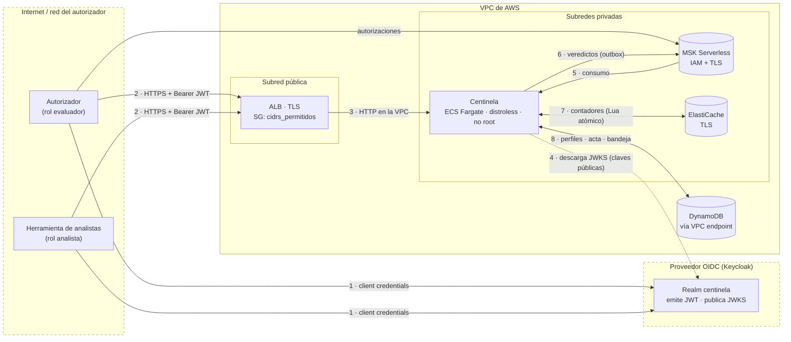

# Modelo de amenazas — Centinela

| | |
|---|---|
| **Sistema** | Centinela, motor de detección de fraude transaccional en tiempo real |
| **Versión analizada** | iteración 7 (`main`, octubre de 2026) |
| **Metodología** | STRIDE por elemento del flujo de datos, con riesgo cualitativo (impacto × probabilidad) |
| **Última revisión** | 2026-10-16 |
| **Próxima revisión** | al cambiar una frontera de confianza, al agregar un consumidor o un endpoint, o antes de 2027-04-16 |

Este documento responde a cuatro preguntas: **qué protegemos, de quién, cómo, y qué queda
abierto**. Cada mitigación apunta al código o al test que la sostiene; una mitigación sin
evidencia en el repositorio se marca como tal. Los riesgos aceptados tienen fecha de revisión,
igual que las excepciones de los escáneres en [`.trivyignore.yaml`](.trivyignore.yaml).

---

## 1. Alcance

**Dentro:** la API REST, el consumo y la publicación por Kafka, el almacenamiento en DynamoDB y
ElastiCache, la imagen de contenedor, la infraestructura en AWS descrita en `terraform/` y el
pipeline de GitHub Actions.

**Fuera:** el autorizador de tarjetas y la herramienta de analistas (consumidores), la operación
del proveedor de identidad en producción, y la seguridad física y de la cuenta de AWS más allá
de lo que define este repositorio.

**Supuestos** que, si dejan de cumplirse, invalidan parte del análisis:

1. El proveedor OIDC de producción se sirve por HTTPS y su operación (parches, copias, acceso
   de administración) es correcta. Terraform exige `https://` en `oidc_issuer_uri`.
2. Los consumidores guardan su `client_secret` en un gestor de secretos, no en código.
3. La cuenta de AWS tiene CloudTrail activo y el acceso humano pasa por SSO con MFA.
4. La API nunca recibe el número de tarjeta completo (PAN): sólo BIN y últimos cuatro dígitos.
   El contrato de entrada no tiene campo para el PAN.

---

## 2. Activos

| ID | Activo | Por qué importa | C | I | D |
|---|---|---|---|---|---|
| AC-1 | **Veredicto de fraude** | Decide si una compra real se aprueba. Alterarlo es fraude directo o pérdida de ventas | | **Alta** | **Alta** |
| AC-2 | **Perfil de comportamiento** | Dónde compra un cliente, con qué dispositivos, cuánto gasta. Dato personal y, en manos de un atacante, el mapa para evadir el motor | **Alta** | Alta | Media |
| AC-3 | **Acta de decisiones** (auditoría) | Prueba de por qué se decidió cada operación; se consulta en disputas y auditorías | Media | **Alta** | Media |
| AC-4 | **Contadores de velocidad** | Alimentan las reglas de ráfaga. Si se resetean, las ráfagas pasan | | Alta | Alta |
| AC-5 | **Credenciales**: secretos de cliente OIDC, claves de firma del emisor, rol de despliegue | Quien las tiene se hace pasar por un consumidor o despliega código | **Alta** | **Alta** | |
| AC-6 | **Política de riesgo** (pesos y umbrales) | Conocerla permite diseñar operaciones que quedan justo por debajo del umbral | Media | Alta | |
| AC-7 | **Cadena de suministro**: dependencias, imagen base, actions del CI | Una pieza comprometida ejecuta código con los permisos del servicio | | **Alta** | |

C = confidencialidad, I = integridad, D = disponibilidad.

---

## 3. Actores

| Actor | Confianza | Acceso legítimo |
|---|---|---|
| **Autorizador** de tarjetas | Sistema de confianza | Rol `evaluador`: pide veredictos y consulta decisiones. Publica autorizaciones en Kafka |
| **Herramienta de analistas** | Sistema de confianza | Rol `analista`: consulta decisiones y perfiles |
| **Balanceador** (ALB) | Infraestructura | Sólo la sonda `/actuator/health` |
| **Pipeline de CI/CD** | Automatización | Despliega por OIDC con un rol acotado al repositorio y a `main` |
| **Atacante externo** | Ninguna | Alcanza el ALB si `cidrs_permitidos` lo permite |
| **Defraudador** | Ninguna | No toca el sistema: opera con tarjetas robadas e intenta que el motor no lo vea |
| **Interno malicioso o cuenta comprometida** | Parcial | Credenciales de un consumidor o acceso a la cuenta de AWS |

El **defraudador** merece mención aparte: es el adversario para el que existe el producto, y
casi nunca ataca la infraestructura. Ataca la lógica. Sus amenazas están en la [sección 6](#6-evasión-del-motor).

---

## 4. Flujo de datos y fronteras de confianza

| Frontera | Entre | Qué la cruza | Control principal |
|---|---|---|---|
| **TB-1** | Internet → ALB | Peticiones de los consumidores | TLS (ACM), security group por CIDR |
| **TB-2** | ALB → aplicación | Peticiones ya descifradas | JWT: firma, `iss`, `aud`, vencimiento y rol |
| **TB-3** | Proveedor OIDC → aplicación | Claves públicas de firma | HTTPS al emisor; `iss` fijo por configuración |
| **TB-4** | Productores de Kafka → aplicación | Autorizaciones a evaluar | IAM de MSK; validación del contrato; cola de descartes |
| **TB-5** | Aplicación → datos | Lecturas y escrituras | IAM sin comodines, TLS, subredes privadas |
| **TB-6** | GitHub → AWS | Imágenes y definiciones de tarea | OIDC con `sub` acotado, tags inmutables, escaneo |

---

## 5. Amenazas STRIDE

Estados: **Mitigado** (con evidencia), **Parcial** (mitigación incompleta, ver riesgo abierto),
**Aceptado** (riesgo asumido con motivo y fecha), **Abierto** (pendiente).

### 5.1 Suplantación (Spoofing)

| ID | Amenaza | Mitigación | Evidencia | Estado |
|---|---|---|---|---|
| S-01 | Un atacante falsifica un JWT o altera el payload de uno real para darse el rol `evaluador` | Firma verificada contra el JWKS del emisor; cualquier cambio en el payload invalida la firma | `SeguridadConKeycloakIT.tokenAlterado` | Mitigado |
| S-02 | Un token válido del mismo realm, emitido para **otro servicio**, se reutiliza contra Centinela | Validación de audiencia: `aud` debe contener `centinela-api` | `SeguridadConKeycloakIT.otraAudiencia`: sin la validación, el test falla con un 201 | Mitigado |
| S-03 | Un token de **otro emisor** (otro realm, otro Keycloak) se acepta | `iss` comparado como texto exacto contra `OIDC_ISSUER_URI`; las claves se bajan sólo de ese emisor | Configuración de `spring.security.oauth2.resourceserver.jwt` | Mitigado |
| S-04 | Se filtra el `client_secret` del autorizador | Tokens de 5 minutos; el secreto se rota en el emisor sin tocar Centinela; cada consumidor tiene el suyo | Realm: `accessTokenLifespan: 300` | Parcial → [A-05](#a-05) |
| S-05 | Un productor no autorizado publica autorizaciones falsas en Kafka | MSK Serverless sólo admite autenticación IAM; los permisos de escritura son del autorizador | `terraform/modules/mensajeria`, `application-prod.yml` (`AWS_MSK_IAM`) | Mitigado |
| S-06 | Se suplanta al emisor OIDC (DNS, MITM) para servir claves propias | HTTPS obligatorio hacia el emisor en producción | Validación de `oidc_issuer_uri` en `terraform/variables.tf` | Mitigado |

### 5.2 Manipulación (Tampering)

| ID | Amenaza | Mitigación | Evidencia | Estado |
|---|---|---|---|---|
| T-01 | Se altera un veredicto en tránsito hacia el autorizador | TLS en el ALB y hacia MSK; el veredicto se publica desde el outbox, no desde la petición | `RelevoDeBandejaDeSalida`, listener HTTPS | Mitigado |
| T-02 | Se modifica el acta de decisiones en DynamoDB | Rol de tarea sin comodines, acotado a las tablas de Centinela; nadie más escribe en ellas | `terraform/modules/servicio/iam.tf` | Parcial → [A-07](#a-07) |
| T-03 | Se resetean o se corrompen los contadores de velocidad | ElastiCache en subred privada con TLS; incrementos con un script Lua atómico | `REDIS_SSL_ENABLED`, adaptador de Redis | Mitigado |
| T-04 | Una dependencia vulnerable o comprometida entra en el build | Dependency-Check (CVSS ≥ 7 rompe el build), Trivy sobre la imagen, revisión semanal programada; parches fijados por encima del BOM con su CVE | [`seguridad.yml`](.github/workflows/seguridad.yml), `pom.xml` | Mitigado |
| T-05 | Una action de terceros del CI se modifica para ejecutar otro código | Actions de terceros fijadas por SHA de commit, no por etiqueta | `aquasecurity/trivy-action@ed142fd…` | Mitigado |
| T-06 | Se reemplaza la imagen desplegada por otra con el mismo tag | ECR con tags inmutables y escaneo al subir; el tag es el SHA del commit; el despliegue corta ante vulnerabilidades críticas | `terraform/modules/ecr`, `deploy.yml` | Mitigado |

### 5.3 Repudio (Repudiation)

| ID | Amenaza | Mitigación | Evidencia | Estado |
|---|---|---|---|---|
| R-01 | Un consumidor niega haber pedido una evaluación concreta | El log registra método, ruta, origen y principal (`azp`) de cada rechazo, pero **el acta no guarda qué cliente pidió cada evaluación** | `RespuestasDeSeguridad`, `EvaluacionDynamo` | Abierto → [A-01](#a-01) |
| R-02 | No se puede reconstruir por qué se tomó una decisión | El acta guarda puntaje, nivel, señales con su evidencia, advertencias de degradación y latencia; la decisión publicada en Kafka lleva además la versión de la política | `EvaluacionDynamo`, `centinela.motor.politica.version` | Mitigado |
| R-03 | Un despliegue no se puede atribuir a un commit | Tag de imagen = SHA del commit; despliegue sólo desde `main` por OIDC | `deploy.yml` | Mitigado |

### 5.4 Revelación de información (Information disclosure)

| ID | Amenaza | Mitigación | Evidencia | Estado |
|---|---|---|---|---|
| I-01 | El autorizador, o quien robe su secreto, lee perfiles de comportamiento | Mínimo privilegio: sólo `analista` lee perfiles. El autorizador no los necesita para su función | `SeguridadDeLaApiTest.Evaluador.noLeePerfiles`, `SeguridadConKeycloakIT.autorizadorNoLeePerfiles` | Mitigado |
| I-02 | Un endpoint nuevo queda expuesto sin que nadie decida quién puede usarlo | Denegación por defecto: `anyRequest().denyAll()` | `SeguridadDeLaApiTest.Generales.rutaNoDeclaradaSeDeniega` | Mitigado |
| I-03 | `/actuator` expone configuración, variables de entorno o métricas internas | En producción sólo la sonda de salud es alcanzable por HTTP; `env` y `configprops` no se exponen | `application.yml`, `rutaNoDeclaradaSeDeniega` (`/actuator/env`, `/actuator/prometheus`) | Mitigado |
| I-04 | Tokens o identificadores de cliente terminan en los logs | El token nunca se escribe; `IdCliente.toString()` devuelve el valor enmascarado | `RespuestasDeSeguridad`, `IdCliente` | Mitigado |
| I-05 | Los mensajes de error revelan detalles internos o confirman qué credencial falló | Problem Details con `codigo` estable; mismo 401 falte o sea inválido el token; manejador de último recurso para el resto | `SeguridadDeLaApiTest.SinToken.tokenInvalido`, `ManejadorDeUltimoRecurso` | Mitigado |
| I-06 | El estado de Terraform contiene secretos | Ningún secreto se genera en Terraform (la autenticación OIDC no necesita secretos en la app); bucket de estado privado y cifrado | `terraform/main.tf`, `terraform/bootstrap` | Mitigado |
| I-07 | Se intercepta un token en tránsito | TLS obligatorio en el ALB (`arn_certificado` sin valor por defecto) | `terraform/variables.tf` | Mitigado |

### 5.5 Denegación de servicio (Denial of service)

| ID | Amenaza | Mitigación | Evidencia | Estado |
|---|---|---|---|---|
| D-01 | Inundación de peticiones contra la API | La autenticación ocurre en la cadena de filtros, **antes** de deserializar el cuerpo; autoescalado de ECS. No hay límite de tasa por cliente | `ConfiguracionDeSeguridad` | Parcial → [A-02](#a-02) |
| D-02 | Un mensaje envenenado bloquea el consumo de Kafka | Errores no reintentables van directo a la cola de descartes con la evidencia; los reintentos tienen tope | `ColaDeDescartesIT` | Mitigado |
| D-03 | Una dependencia lenta (DynamoDB, Redis) hace que la autorización exceda su tiempo | Presupuesto de latencia: al agotarse, el motor decide con lo que tiene y marca la decisión como degradada | `MotorDeReglasTest`, ADR-0010 | Mitigado |
| D-04 | Payloads JSON maliciosos agotan CPU o memoria del parser | Jackson parcheado contra los CVE de DoS de 2026 y vigilado por Trivy y Dependency-Check. No hay un límite explícito de tamaño de cuerpo más allá de los de Tomcat | `pom.xml` (`jackson-bom.version`) | Parcial → [A-02](#a-02) |
| D-05 | El emisor OIDC cae y la API rechaza todo | Las claves públicas se cachean tras la primera descarga; los tokens ya emitidos siguen validándose. Una caída larga del emisor sí impide emitir tokens nuevos | Comportamiento de `NimbusJwtDecoder` | Aceptado → [A-06](#a-06) |

### 5.6 Elevación de privilegios (Elevation of privilege)

| ID | Amenaza | Mitigación | Evidencia | Estado |
|---|---|---|---|---|
| E-01 | Un `analista` pide evaluaciones, o un token sin roles opera | Autorización por rol en cada operación | `SeguridadDeLaApiTest.Analista.noEvalua`, `Generales.sinRoles` | Mitigado |
| E-02 | Un rol de cliente de Keycloak (`resource_access`) se usa para escalar permisos | Sólo cuentan los roles del realm; el convertidor ignora los de cliente | `ConvertidorDeRolesDeKeycloakTest.ignoraRolesDeCliente` | Mitigado |
| E-03 | Un claim con forma inesperada provoca un error que se interpreta como autorizado | Claim malformado = token sin roles = 403, nunca 500 ni acceso | `ConvertidorDeRolesDeKeycloakTest.claimMalformado` | Mitigado |
| E-04 | Una vulnerabilidad en la app da una shell en el contenedor | Imagen distroless sin shell ni gestor de paquetes, usuario no root (UID 10001), binario nativo | `Dockerfile` | Mitigado |
| E-05 | Un workflow de una rama o un fork asume el rol de despliegue | Rol OIDC con `sub` acotado a este repositorio y a `main`; `iam:PassRole` limitado | `terraform/bootstrap` | Mitigado |
| E-06 | Desde una tarea comprometida se sale a internet para exfiltrar datos | DynamoDB y S3 salen por VPC endpoints, pero el security group permite salida a `0.0.0.0/0` | `terraform/modules/red` | Parcial → [A-04](#a-04) |

---

## 6. Evasión del motor

Amenazas del defraudador contra la lógica del producto. No encajan en STRIDE porque no atacan
la seguridad del sistema sino su propósito.

| ID | Amenaza | Mitigación | Estado |
|---|---|---|---|
| F-01 | **Envenenar el perfil**: hacer compras pequeñas desde un país nuevo para que pase a ser "habitual" | El perfil sólo aprende de operaciones aprobadas sin fricción, y sólo si la lectura del perfil fue concluyente (ADR-0013) | Mitigado |
| F-02 | **Partir la ráfaga** a caballo de dos ventanas fijas de los contadores para colar hasta el doble | Ninguna todavía: la ventana es fija | Abierto → [A-08](#a-08) |
| F-03 | **Inducir degradación** para que el motor decida sin datos | La degradación no se colapsa con "regla no disparada": queda en las advertencias de la decisión y en métricas | Mitigado |
| F-04 | **Sondear umbrales** con operaciones de importe creciente | Las respuestas exponen el puntaje y las señales al consumidor de confianza, no al titular; la política está versionada y sus pesos fuera del código | Parcial: un consumidor comprometido vería los puntajes |

---

## 7. Riesgos abiertos y aceptados

| ID | Riesgo | Tratamiento propuesto | Decisión | Revisar |
|---|---|---|---|---|
| **A-01** | El acta no registra qué cliente (`azp`) pidió cada evaluación por la API (R-01) | Agregar el solicitante a `EvaluacionDeFraude` como metadato de auditoría y persistirlo | **Abierto**: siguiente iteración | 2026-12-31 |
| **A-02** | Sin límite de tasa por cliente ni de tamaño de cuerpo explícito (D-01, D-04) | AWS WAF delante del ALB con reglas por IP y tamaño de cuerpo; límite de tasa por `azp` en la aplicación | Abierto | 2027-01-31 |
| **A-03** | `cidrs_permitidos` vale `0.0.0.0/0` por defecto | Acotarlo es paso obligatorio del despliegue ([DESPLIEGUE.md](DESPLIEGUE.md), paso 3) | Aceptado mientras no haya despliegue | Antes del primer `apply` |
| **A-04** | Salida abierta del security group de las tareas (E-06) | Limitar al CIDR de la VPC y a los prefix lists de los endpoints, tras inventariar dependencias externas (incluido el emisor OIDC) | Aceptado; excepción en `.trivyignore.yaml` | 2027-01-31 |
| **A-05** | `client_secret` estáticos (S-04) | Autenticación de cliente con `private_key_jwt` o mTLS: no hay secreto compartido que filtrar | Aceptado para desarrollo | 2027-04-30 |
| **A-06** | Dependencia de disponibilidad del emisor OIDC (D-05) | Keycloak en alta disponibilidad; alarma sobre errores de descarga del JWKS | Aceptado | 2027-04-30 |
| **A-07** | El acta es modificable por el propio rol de la aplicación (T-02) | Exportación periódica a S3 con Object Lock, o tabla de solo-inserción con un rol distinto | Aceptado | 2027-04-30 |
| **A-08** | Ventana fija de los contadores (F-02) | Ventana deslizante con sorted sets en Redis | Abierto (ver *Pendiente* en el README) | 2027-01-31 |

---

## 8. Controles verificados automáticamente

Lo que se comprueba en cada push. Si alguno de estos tests deja de pasar, el control dejó de existir.

| Control | Dónde se verifica |
|---|---|
| Firma, emisor y audiencia del JWT contra un Keycloak real | `SeguridadConKeycloakIT` (Testcontainers) |
| Matriz de permisos por rol y denegación por defecto | `SeguridadDeLaApiTest` |
| Formato y contenido de los 401 y 403 | `SeguridadDeLaApiTest.SinToken` |
| Extracción de roles de Keycloak | `ConvertidorDeRolesDeKeycloakTest` |
| El dominio no depende de Spring ni de AWS | `ArquitecturaHexagonalTest` (ArchUnit) |
| Vulnerabilidades en dependencias (CVSS ≥ 7) | Dependency-Check en [`seguridad.yml`](.github/workflows/seguridad.yml) |
| Análisis estático del código (inyecciones, deserialización, SSRF…) | CodeQL `security-extended` |
| Vulnerabilidades altas y críticas con arreglo en la imagen | Trivy (puerta) |
| Configuración insegura del Terraform | Trivy `config` (puerta) |

---

## 9. Cómo mantener este documento

- **Un endpoint nuevo** obliga a decidir su rol en `ConfiguracionDeSeguridad` (nace denegado),
  agregar su fila a la matriz de `SeguridadDeLaApiTest` y revisar la sección 5.4.
- **Un consumidor nuevo** es un cliente nuevo en el realm con su propio rol: nunca compartir el
  de otro.
- **Una excepción nueva en un escáner** lleva motivo, archivo y vencimiento, y si es un riesgo
  real, su fila en la sección 7.
- Al cerrar un riesgo abierto, se mueve su amenaza a **Mitigado** con la evidencia nueva.
